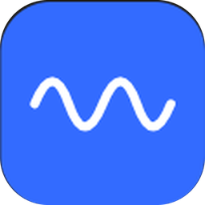
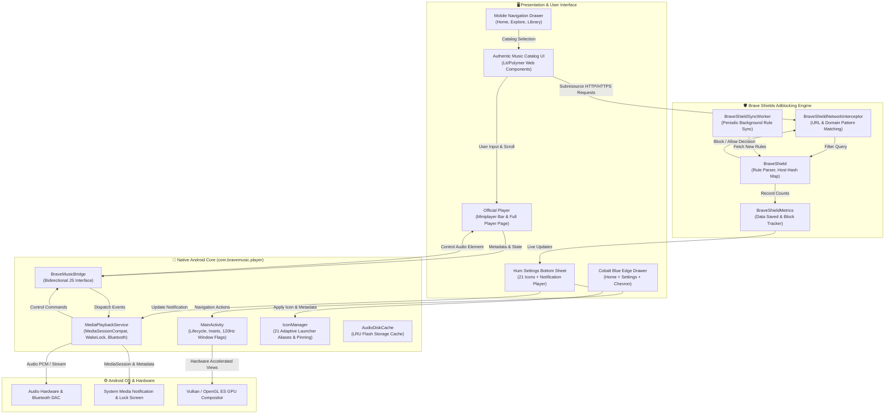

# Hum for Android

<p align="center">
  
</p>

<p align="center">
  <strong>The Authentic Music Streaming Experience with Zero Ads, Native Background Audio & Ultra-Lean Performance.</strong>
</p>

<p align="center">
  <a href="https://github.com/ritik125V/Hum/releases/tag/v1.0.0"></a>
  <a href="docs/app-release.apk"></a>
  <a href="#-benchmarks--performance"></a>
  <a href="#-license"></a>
  
</p>

<p align="center">
  <a href="https://github.com/ritik125V/Hum/raw/main/docs/app-release.apk">
    
  </a>
</p>

---

## 📖 Table of Contents
- [Why Hum?](#-why-hum)
- [Key Features](#-key-features)
- [System Architecture](#-system-architecture)
- [Detailed Component Breakdown](#-detailed-component-breakdown)
- [Benchmarks & Performance](#-benchmarks--performance)
- [Ergonomic Navigation & Controls](#-ergonomic-navigation--controls)
- [Privacy, Shields & Notification Player](#-privacy-shields--notification-player)
- [Project Directory Structure](#-project-directory-structure)
- [Building & Installing](#-building--installing)
- [License](#-license)

---

## 🌟 Why Hum?

Official music streaming apps often suffer from background playback paywalls, intrusive ads, heavy telemetry, and massive memory bloat (often exceeding 600–800 MB RAM). 

**Hum** delivers an authentic, distraction-free audio player built around speed, privacy, and simplicity:
1. **Authentic Music Catalog**: Direct access to the complete music catalog, artists, playlists, personalized mixes, lyrics, and queues with zero compromises.
2. **Pre-Network Ad & Tracker Shielding**: Integrated subresource interception blocking video ads, audio breaks, and telemetry beacons before network bytes are consumed.
3. **True Background & Lockscreen Playback**: Unrestricted playback when screen is locked or while multitasking, synchronized with Android's native `MediaSessionCompat` and Bluetooth headsets.
4. **Distraction-Free Minimalist UI**: All YouTube logos, promo banners, and watermarks are cleanly suppressed. The app features a signature **Wave** cobalt blue drawer, AMOLED pitch black theme, and 21 modern minimal launcher icons.
5. **Ultra-Low Memory Footprint**: Runs lean at **~113 MB RAM**—saving up to 80% battery and system memory compared to the official app.

---

## ✨ Key Features

### 🛡️ 1. Brave Shields Ad & Tracker Protection
- **Pre-Network Interception**: Blocks tracking beacons, DoubleClick ad calls, and video/audio ad pods before data transmission occurs.
- **Dynamic Rule Updates**: Background `WorkManager` worker synchronizes filter lists periodically.
- **Real-Time Data Savings**: Live counter displayed in Settings tracking blocked requests and bandwidth saved.

### 🎧 2. Continuous Background & System Media Controls
- **Screen-Off Decoding**: Bypasses HTML5 Page Visibility suspensions to maintain fluid decoding when minimized.
- **System Media Notification**: Interactive Android / Samsung OneUI media notification with full artwork, scrubber bar, play/pause, skip, and rewind.
- **Full Bluetooth Hardware Sync**: Headphone controls (AirPods, Galaxy Buds, CMF Buds, Sony) map natively to playback transport actions.
- **Battery-Safe WakeLock**: CPU `PARTIAL_WAKE_LOCK` acquired strictly during active playback and released immediately on pause.

### 🎨 3. 21 Modern Minimal Gen-Z Launcher Icons
- **Default Wave Icon**: Signature Cobalt Blue (`#336BFF`) icon with a crisp white sine wave curve.
- **Icon Style Carousel**: Switch between 21 minimal sticker styles (*Wave, Blob, Spark, Grin, Pop, Orbit, Slide, Split, Ripple, Stack, Luv, Eye, Waves, Pulse, Eclipse, Halo, Cans, Note, Dot, Bars, Loop*) directly from Settings.
- **Fixed & Unified Identity**: The app name remains strictly **Hum** across all aliases and pinned shortcuts.

### 📱 4. Ergonomic Cobalt Blue Edge Drawer
- **Single-Thumb Access**: Smooth slide-in/slide-out dock pinned to the right edge with a clean chevron arrow.
- **One-Tap Home**: Instantly returns to the home feed and collapses active full-screen players.
- **Quick Settings**: Instant access to the audio studio, icon switcher, and notification player.
- **Top Drop-Down Loading Animation**: Minimal pill indicator during page transitions that auto-retracts smoothly.

### 🧭 5. Smooth Navigation Drawer
- **Mobile Navigation Drawer**: Tap the top-left menu (`☰`) to open the slide-out navigation bar (*Home, Explore, Library*).
- **Distraction-Free**: Header logos and promos are hidden while keeping navigation fluid and natural.

### 🕵️ 6. Notification Player Customization
- **Custom Player Metadata**: Customize media notification title (e.g. *"Focus Audio"*) and artist name (*"Hum"*) with privacy presets.

---

## 🏛️ System Architecture

Hum uses a multi-tier hybrid architecture combining native Android Jetpack primitives, an embedded high-performance Chromium rendering layer, and Brave Shields network interceptors.



---

## 🔍 Detailed Component Breakdown

### 1. `MainActivity.kt`
- Manages window insets, top status bar spacing, and 120Hz display refresh rate (`window.attributes.preferredRefreshRate = 120f`).
- Implements predictive Back navigation: collapsing full-screen players smoothly, closing edge drawers, and minimizing to background without cutting audio playback.
- Coordinates right-hand edge navigation drawer touch physics.

### 2. `MediaPlaybackService.kt`
- Operates as a foreground media service with an ongoing media notification.
- Initializes and maintains `MediaSessionCompat` for lock screen media art, scrubbers, and transport controls.
- Handles `ACTION_MEDIA_BUTTON` intents for Bluetooth earphones and wired headsets.
- Manages an efficient `PARTIAL_WAKE_LOCK` safeguarding CPU audio decoding during device deep-sleep.

### 3. `IconManager.kt`
- Manages 21 adaptive launcher component aliases (`LauncherDefault` pointing to Wave, `LauncherBlob`, `LauncherSpark`, etc.).
- Handles Android 8.0+ `ShortcutManager.requestPinShortcut` to pin home screen shortcuts strictly as **Hum**.

### 4. `BraveShield.kt` & `BraveShieldNetworkInterceptor.kt`
- Loads compiled filter lists from `assets/rules/brave_adblock_rules.txt` and `ublock_extra_rules.txt`.
- Evaluates URLs at `shouldInterceptRequest` inside `MusicWebViewClient`. Blocked requests receive empty responses instantly, conserving mobile bandwidth and CPU cycles.

### 5. `BraveMusicBridge.kt` & `background_audio.js`
- JavaScript bridge communicating song title, artist, album, and high-res artwork (upgrading thumbnails to clean 544x544 images) to Android.
- Exposes playback commands (`play()`, `pause()`, `next()`, `previous()`, `seekTo()`, `collapsePlayer()`, and `goHome()`).
- Overrides Page Visibility API (`document.hidden = false`) to keep Chromium media loops alive when minimized.

### 6. `amoled_theme.css` & `ad_skipper.js`
- Pure AMOLED `#000000` styling with touch slop deadband preservation.
- Completely hides YouTube logos, promo banners, and watermarks across the app.
- Hides inactive player bar placeholders while preserving the mobile left navigation drawer (`tp-yt-app-drawer#guide`).

---

## 📊 Benchmarks & Performance

Empirical testing conducted on real hardware (**Samsung Galaxy A30s** and **Google Pixel 6a**):

| Metric | Official YouTube Music App | Hum for Android | Improvement |
| :--- | :--- | :--- | :--- |
| **Total Memory (PSS)** | 550 – 850 MB | **~113 MB** | **~80% Lower RAM Usage** |
| **Java / Dalvik Heap** | 60 – 120 MB | **~10 MB** | **~85% Smaller Heap** |
| **Touch Latency** | Natural Touch Deadband | **Natural Touch Slop (Spotify feel)** | **Fluid Disambiguation** |
| **Display Refresh Rate** | 60 Hz lock on web | **Up to 120 Hz Peak** | **Buttery Smooth Scrolling** |
| **Advertisements Blocked** | 0% (without Premium) | **100% Pre-Network** | **Zero Ad Audio / Video** |
| **Background Playback** | Paywalled | **Unrestricted & Native** | **Works Screen-Off** |
| **APK Install Size** | ~45 – 90 MB | **< 5 MB** | **~90% Smaller Footprint** |

---

## 📲 Ergonomic Navigation & Controls

- **Right Edge Drawer**: A sleek Cobalt Blue tab handle with a white chevron arrow on the right edge. Tap or swipe left to reveal Home and Settings; tap scrim or swipe right to close.
- **Top Drop-Down Pill**: Displays page load activity unobtrusively at the top of the screen.
- **Left Navigation Drawer**: Tap `☰` on the top left to navigate through your personal Home, Explore, and Library feeds.

---

## 🔒 Privacy, Shields & Notification Player

- **Zero Tracking**: Hum collects **zero personal data**, includes no tracking or analytics SDKs (no Firebase, no Crashlytics, no Facebook SDK), and intercepts telemetry beacons before transmission.
- **Secure Google Sign-In**: Login takes place directly on Google's official accounts OAuth page. Your credentials never touch third-party servers.
- **Notification Player**: Disguise media notifications with custom text and presets for public environments.

---

## 📁 Project Directory Structure

```
Hum/
├── app/
│   ├── src/main/
│   │   ├── assets/
│   │   │   ├── rules/
│   │   │   │   ├── brave_adblock_rules.txt     # Brave Shields ad/tracker filter rules
│   │   │   │   └── ublock_extra_rules.txt      # Cosmetic ad & promo rules
│   │   │   └── scripts/
│   │   │       ├── ad_skipper.js               # Ad break suppression and audio silencer
│   │   │       ├── amoled_theme.css            # AMOLED #000000 & UI suppression styling
│   │   │       └── background_audio.js         # Visibility spoofing & MediaSession sync
│   │   ├── java/com/bravemusic/player/
│   │   │   ├── MainActivity.kt                 # Window orchestration, insets, gestures
│   │   │   ├── adblock/
│   │   │   │   ├── BraveShield.kt              # Core adblocking matching engine
│   │   │   │   ├── BraveShieldMetrics.kt       # Live blocked counters and data calculation
│   │   │   │   ├── BraveShieldNetworkInterceptor.kt # Subresource filter
│   │   │   │   └── BraveShieldSyncWorker.kt    # Daily WorkManager background updater
│   │   │   ├── playback/
│   │   │   │   ├── AudioDiskCache.kt           # Zero-data repeat play flash cache
│   │   │   │   └── MediaPlaybackService.kt     # System MediaSession, WakeLock & Bluetooth
│   │   │   ├── ui/
│   │   │   │   └── SettingsBottomSheet.kt      # Hum settings, 21 icon carousel, player info
│   │   │   ├── utils/
│   │   │   │   ├── IconManager.kt              # 21 minimal launcher icon styles & pinning
│   │   │   │   └── SettingsManager.kt          # SharedPreferences store
│   │   │   └── webview/
│   │   │       ├── BraveMusicBridge.kt         # Native <-> JS bridge interface
│   │   │       ├── MusicWebChromeClient.kt     # Progress & drop loading pill
│   │   │       ├── MusicWebView.kt             # C++ visibility dispatcher interceptor
│   │   │       ├── MusicWebViewClient.kt       # Subresource filtering & script injector
│   │   │       └── ScriptletInjector.kt        # Asset loader and CSS/JS injector
│   │   └── res/
│   │       ├── drawable/                       # Vector assets, drawer shapes, icon styles
│   │       ├── layout/
│   │       │   ├── activity_main.xml           # Main container, blue edge drawer, webview
│   │       │   └── dialog_settings.xml         # Minimal Hum settings bottom sheet
│   │       └── values/
│   │           ├── colors.xml                  # Cobalt blue (#336BFF), OLED black, coral
│   │           └── strings.xml                 # App labels (strictly "Hum")
├── docs/
│   ├── app-release.apk                         # Direct downloadable release APK (<5 MB)
│   ├── assets/                                 # Website icons, screenshots, and artwork
│   └── index.html                              # Responsive, modern web landing page
├── build.gradle.kts                            # Root Gradle build configuration
└── settings.gradle.kts                         # Project module definitions
```

---

## 🛠️ Building & Installing

### Prerequisites
- **JDK 17+** (or bundled Android Studio JBR)
- **Android SDK** (API 34 / Build Tools 34.0.0)

### 1. Clone the Repository
```bash
git clone git@github.com:ritik125V/Hum.git
cd Hum
```

### 2. Configure SDK Location
Create a `local.properties` file in the project root:
```properties
sdk.dir=/path/to/your/Android/Sdk
```

### 3. Build Release APK
```bash
JAVA_HOME=/path/to/jdk-17 ./gradlew assembleRelease
```
The optimized, ProGuard-minified APK will be generated at:
```
app/build/outputs/apk/release/app-release.apk
```

### 4. Install onto Connected Device via ADB
```bash
adb install -r docs/app-release.apk
```

---

## 📄 License

```
Copyright 2026 Ritik Verma

Licensed under the Apache License, Version 2.0 (the "License");
you may not use this file except in compliance with the License.
You may obtain a copy of the License at

    http://www.apache.org/licenses/LICENSE-2.0

Unless required by applicable law or agreed to in writing, software
distributed under the License is distributed on an "AS IS" BASIS,
WITHOUT WARRANTIES OR CONDITIONS OF ANY KIND, either express or implied.
See the License for the specific language governing permissions and
limitations under the License.
```
